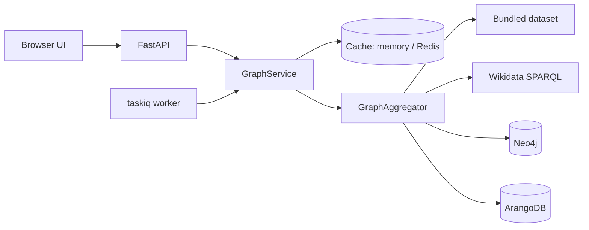

# Pantheon Graph

[](https://github.com/AI-Stratov/pantheon_graph/actions/workflows/ci.yml)


An interactive map of the Greek pantheon. Family ties are collected from several
graph sources — **Wikidata**, **Neo4j**, **ArangoDB** and a bundled dataset —
merged into one graph and explored in the browser with Cytoscape.

- Search, neighbourhood highlighting, relation filters, four layouts, PNG export, light and dark themes
- Every source is optional; a slow or broken one is skipped while the rest keep serving
- Read-through cache in memory or Redis, refreshed on a schedule by a background worker
- One command loads the bundled pantheon into Neo4j or ArangoDB for a full local demo

## Quick start

With [uv](https://docs.astral.sh/uv/) and Python 3.13:

```bash
uv sync
uv run pantheon-graph            # http://127.0.0.1:8080
```

The bundled dataset needs no external services. Copy `.env.example` to `.env`
to switch other sources on.

### Everything in Docker

```bash
docker compose up -d --build                    # web + worker + scheduler + Redis
docker compose --profile databases up -d        # also start Neo4j and ArangoDB
docker compose run --rm web pantheon-graph seed neo4j
docker compose run --rm web pantheon-graph seed arango
```

Then enable the databases in `.env` and restart the app:

```dotenv
PANTHEON_NEO4J__ENABLED=true
PANTHEON_ARANGO__ENABLED=true
```

Compose already points the containers at the bundled services, with
`pantheon-secret` as the default password (override with `NEO4J_PASSWORD` /
`ARANGO_PASSWORD`).

## Architecture



The code follows a ports-and-adapters layout; dependencies only point inwards.

```
src/pantheon_graph/
├── domain/          immutable Graph / Node / Edge and graph algorithms, no framework imports
├── application/     ports (Protocols), GraphAggregator and GraphService use cases
├── infrastructure/  sources (memory, Wikidata, Neo4j, ArangoDB), caches, database seeding
├── web/             FastAPI routes, response schemas, static single-page UI
├── ioc.py           dishka container shared by the web app and the worker
├── worker.py        taskiq broker, scheduler and the refresh task
├── config.py        typed settings from PANTHEON_* environment variables
└── cli.py           `pantheon-graph serve | seed`
```

Sources agree on a small vocabulary: node `kind` (god, goddess, titan, …) and
edge `kind` (`parent`, `spouse`, `sibling`). Parent edges always point from parent
to child, symmetric relations are stored once per pair, and nodes keep stable
IDs, so the same deity coming from different sources collapses into one node.

## API

Interactive docs are served at `/docs`.

| Method | Path                               | Description                                          |
|--------|------------------------------------|------------------------------------------------------|
| GET    | `/health`                          | Cache and source status; 503 when nothing can serve  |
| GET    | `/api/graph`                       | The whole merged graph                               |
| POST   | `/api/graph/refresh`               | Reload every source and update the cache             |
| GET    | `/api/graph/stats`                 | Node and edge counts by kind                         |
| GET    | `/api/graph/search?q=`             | Search nodes by label                                |
| GET    | `/api/graph/relationships`         | Filter edges by `node`, `source`, `target`, `kind`, `label` |
| GET    | `/api/graph/nodes/{id}?depth=1..3` | A node with everything within `depth` hops           |

## Configuration

All settings are environment variables with the `PANTHEON_` prefix (a `.env` file
works too); nested sections use a double underscore. See
[`.env.example`](.env.example) for the full list.

| Variable                                   | Default                 | Purpose                              |
|--------------------------------------------|-------------------------|--------------------------------------|
| `PANTHEON_HOST` / `PANTHEON_PORT`          | `127.0.0.1` / `8080`    | Bind address                         |
| `PANTHEON_MEMORY__ENABLED`                 | `true`                  | Bundled dataset                      |
| `PANTHEON_WIKIDATA__ENABLED`               | `false`                 | Wikidata SPARQL source               |
| `PANTHEON_NEO4J__ENABLED`, `__URI`, `__PASSWORD` | `false`           | Neo4j source                         |
| `PANTHEON_ARANGO__ENABLED`, `__URL`, `__GRAPH`   | `false`           | ArangoDB source                      |
| `PANTHEON_REDIS_URL`                       | —                       | Shared cache and task broker         |
| `PANTHEON_CACHE_TTL`                       | `3600`                  | Snapshot lifetime, `0` keeps it forever |
| `PANTHEON_REFRESH_CRON`                    | `*/30 * * * *`          | Background refresh schedule          |
| `PANTHEON_SOURCE_TIMEOUT`                  | `30`                    | Time budget per source, seconds      |
| `PANTHEON_PUBLIC_API_BASE`, `PANTHEON_CORS_ORIGINS` | —              | Serving the UI from another origin   |

## Background refresh

With Redis configured, the worker rebuilds the cached graph on the
`PANTHEON_REFRESH_CRON` schedule so web requests never wait for slow sources:

```bash
uv run taskiq worker pantheon_graph.worker:broker
uv run taskiq scheduler pantheon_graph.worker:scheduler
```

## Development

```bash
uv sync                      # installs dev tools too
uv run pre-commit install
uv run pytest
uv run ruff check && uv run ruff format --check
uv run mypy
```

## License

[MIT](LICENSE)
