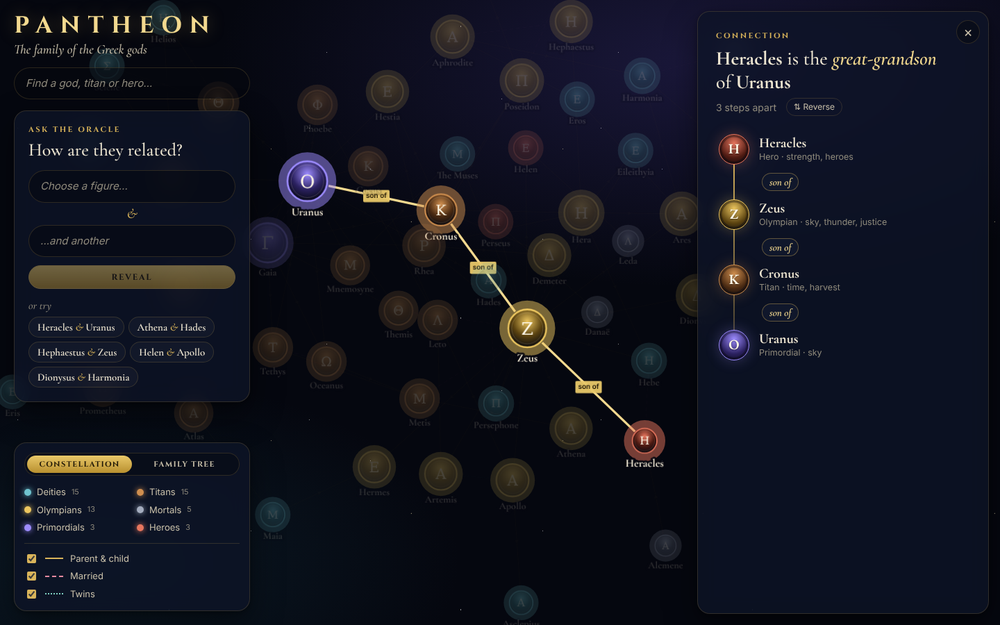
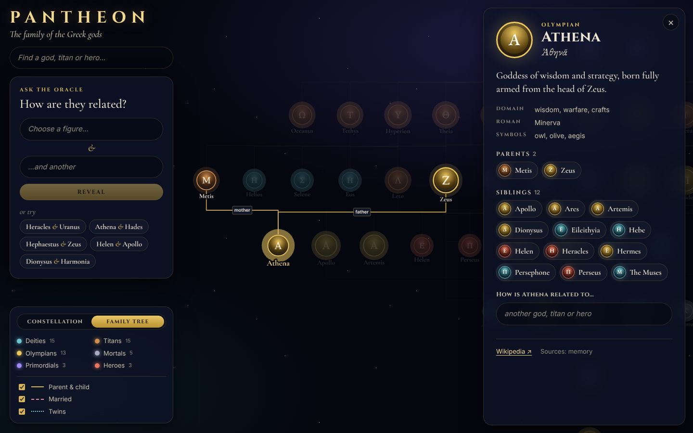
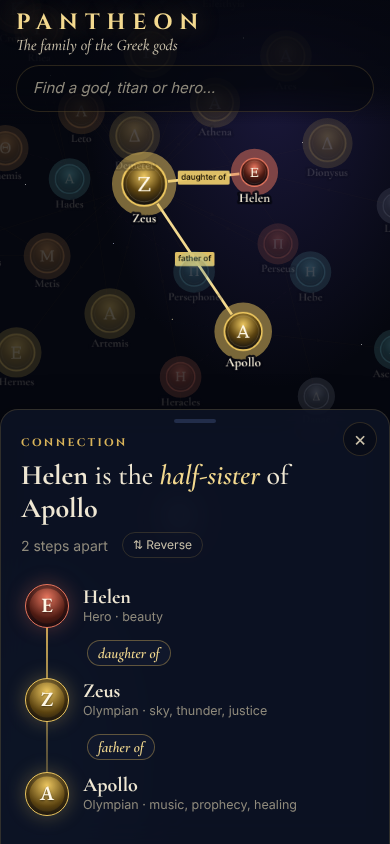
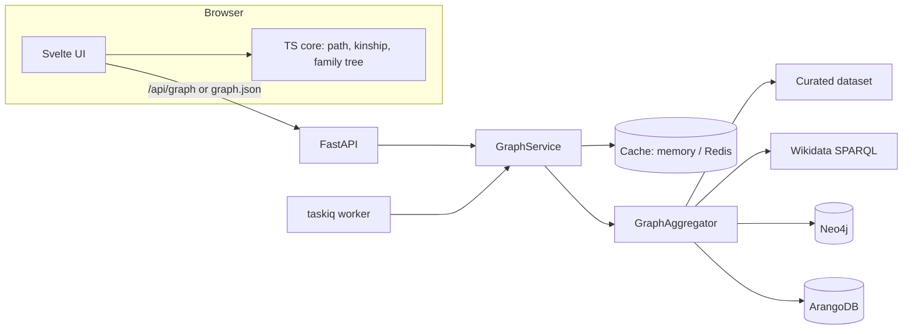

# Pantheon

[](https://github.com/AI-Stratov/pantheon_graph/actions/workflows/ci.yml)


**The family of the Greek gods as a night sky.** Fifty-odd primordials, Titans,
Olympians, heroes and mortals, every parent, marriage and twin between them —
and an oracle that tells you how any two of them are related.

**[Open the live demo →](https://ai-stratov.github.io/pantheon_graph/)** · ask it
[how Heracles is related to Uranus](https://ai-stratov.github.io/pantheon_graph/?from=heracles&to=uranus)



<table>
  <tr>
    <td width="68%"></td>
    <td></td>
  </tr>
</table>

## What it does

- **Names the relationship, not just the path.** "Hephaestus is the *stepson* of Zeus",
  "Athena is the *niece* of Hades", "Helen is the *half-sister* of Apollo" — parents,
  grandparents with any number of *greats*, siblings and half-siblings, uncles and
  nieces, cousins, step- and in-law relations, with the chain spelled out step by step.
- **Two ways to see the family.** A force-directed *constellation*, and a *family tree*
  with one row per generation and genealogical connectors.
- **Every view is a link** — `?node=athena`, `?from=helen&to=apollo`, `?layout=tree`.
- **Works on a phone**: bottom sheet, readable zoom, the oracle one tap away.
- **Several data sources, one family.** A curated dataset (genealogy after Hesiod's
  *Theogony*, with Greek names, attributes and descriptions), Wikidata, Neo4j and
  ArangoDB are merged into one graph: the same figure reported by two sources becomes
  one node, and the same marriage reported twice stays one edge.

## Quick start

Needs Python 3.13 with [uv](https://docs.astral.sh/uv/) and Node 22.

```bash
npm --prefix frontend ci && npm --prefix frontend run build   # UI → src/pantheon_graph/web/dist
uv sync
uv run pantheon-graph                                         # http://127.0.0.1:8080
```

While working on the UI, run the API and Vite side by side — Vite proxies `/api`:

```bash
uv run pantheon-graph serve --reload
npm --prefix frontend run dev                                 # http://127.0.0.1:5173
```

### Docker

```bash
docker compose up -d --build                     # web + worker + scheduler + Redis
docker compose --profile databases up -d         # also Neo4j and ArangoDB
docker compose run --rm web pantheon-graph seed neo4j
docker compose run --rm web pantheon-graph seed arango
```

Then set `PANTHEON_NEO4J__ENABLED=true` / `PANTHEON_ARANGO__ENABLED=true` in `.env`
and restart. The image builds the UI itself, no local Node needed.

### Static demo

The UI also runs without a backend: `export` builds the graph from every enabled
source and writes a self-contained site that reads a JSON snapshot.

```bash
uv run pantheon-graph export site       # serve ./site from any static host
```

The [Demo workflow](.github/workflows/demo.yml) publishes it to GitHub Pages on every
push to `main` (enable once: *Settings → Pages → Source: GitHub Actions*).

## Architecture



```
frontend/                       Vite + TypeScript + Svelte 5
├── src/lib/                    framework-free core, unit-tested with Vitest
│   ├── graph.ts                index, BFS path (same tie-break as the server), relatives, search
│   ├── kinship.ts              "great-grandson", "half-sister", "stepmother"...
│   ├── familyTree.ts           generational layout
│   └── state.svelte.ts         URL-backed UI state
├── src/components/             canvas (Cytoscape), cards, oracle, responsive panel
└── e2e/                        Playwright against the real backend, desktop and mobile

src/pantheon_graph/             Python, ports and adapters
├── domain/                     immutable Graph with merge, shortest path, neighbourhood
├── application/                ports (Protocols), aggregator, read-through GraphService
├── infrastructure/             sources, caches, database seeding
├── web/                        API routes and schemas, serving and exporting the built UI
├── ioc.py                      dishka container shared by the API and the worker
├── worker.py                   taskiq refresh task and scheduler
└── cli.py                      pantheon-graph serve | seed | export
```

## API

Interactive docs at `/docs`.

| Method | Path                               | Description                                             |
|--------|------------------------------------|---------------------------------------------------------|
| GET    | `/health`                          | Cache and source status; 503 when nothing can serve     |
| GET    | `/api/graph`                       | The whole merged graph                                  |
| POST   | `/api/graph/refresh`               | Reload every source and update the cache                |
| GET    | `/api/graph/path?source=&target=`  | Shortest chain of relationships, in walking order       |
| GET    | `/api/graph/nodes/{id}?depth=1..3` | A figure with everything within `depth` steps           |
| GET    | `/api/graph/search?q=`             | Search by name                                          |
| GET    | `/api/graph/relationships`         | Filter edges by `node`, `source`, `target`, `kind`, `label` |
| GET    | `/api/graph/stats`                 | Counts by kind                                          |

## Configuration

Environment variables with the `PANTHEON_` prefix (or a `.env` file); nested sections
use a double underscore. See [`.env.example`](.env.example) for everything.

| Variable                                         | Default              | Purpose                                 |
|--------------------------------------------------|----------------------|-----------------------------------------|
| `PANTHEON_HOST` / `PANTHEON_PORT`                | `127.0.0.1` / `8080` | Bind address                            |
| `PANTHEON_MEMORY__ENABLED`                       | `true`               | Curated dataset                         |
| `PANTHEON_WIKIDATA__ENABLED`                     | `false`              | Wikidata SPARQL source                  |
| `PANTHEON_NEO4J__ENABLED`, `__URI`, `__PASSWORD` | `false`              | Neo4j source                            |
| `PANTHEON_ARANGO__ENABLED`, `__URL`, `__GRAPH`   | `false`              | ArangoDB source                         |
| `PANTHEON_REDIS_URL`                             | —                    | Shared cache and task broker            |
| `PANTHEON_CACHE_TTL`                             | `3600`               | Snapshot lifetime, `0` keeps it forever |
| `PANTHEON_REFRESH_CRON`                          | `*/30 * * * *`       | Background refresh schedule             |
| `PANTHEON_PUBLIC_API_BASE`, `PANTHEON_CORS_ORIGINS` | —                 | Serving the UI from another origin      |

## Development

```bash
uv sync && uv run pre-commit install
uv run pytest && uv run ruff check && uv run mypy        # Python
cd frontend && npm run check && npm test                  # TypeScript
npm run build && npm run e2e                              # end-to-end, needs `uv sync`
```

## License

[MIT](LICENSE)
